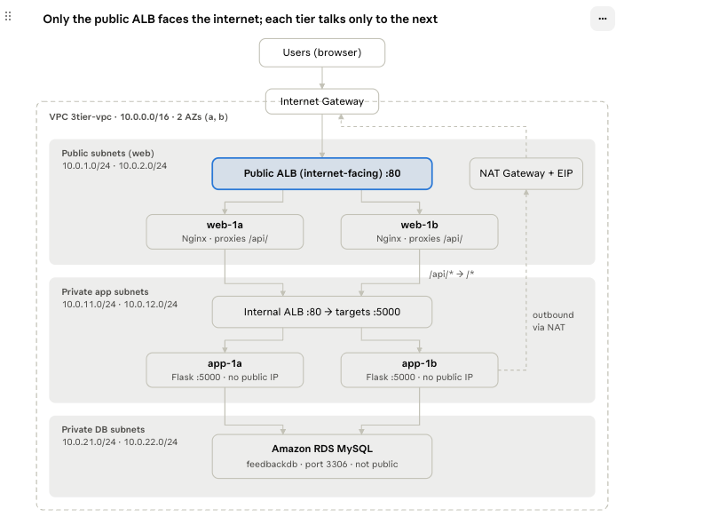

# Project-01: Scalable, Secure 3-Tier Web Application on AWS

A Python (Flask) feedback application deployed on AWS using a classic **3-tier architecture**: a public web tier (Nginx), a private application tier (Flask), and a private database tier (Amazon RDS MySQL), spread across two Availability Zones for high availability.

Users submit feedback through a web form. The request travels through two load balancers and is stored in MySQL.



---

## Request flow

```
Browser
   │  HTTP :80
   ▼
Public ALB (internet-facing)          ← public-alb-sg: 80 from anywhere
   │
   ▼
Web tier: Nginx on EC2 (web-1a, web-1b)  ← web-sg: 80 from public ALB only
   │  /       → serves index.html
   │  /api/*  → reverse proxy
   ▼
Internal ALB (app-alb)                ← internal-alb-sg: 80 from web tier only
   │  forwards to port 5000
   ▼
App tier: Flask on EC2 (app-1a, app-1b)  ← app-sg: 5000 from internal ALB only
   │  PyMySQL
   ▼
Amazon RDS MySQL 8.4 (feedbackdb)     ← db-sg: 3306 from app tier only
```

---

## AWS services used

| Service | Purpose |
|---|---|
| Amazon VPC | Custom network with public and private subnets across 2 AZs |
| Internet Gateway | Internet access for the public subnets |
| NAT Gateway + Elastic IP | Outbound-only internet for private app servers (package installs) |
| Amazon EC2 (t3.micro, Ubuntu) | 2 web servers + 2 app servers |
| Application Load Balancer ×2 | Internet-facing ALB for the web tier, internal ALB for the app tier |
| Amazon RDS for MySQL | Managed database in private subnets, not publicly accessible |
| Security Groups | Tier-to-tier least-privilege firewall chain |

**Region:** us-east-1 (N. Virginia) · **Availability Zones:** us-east-1a, us-east-1b

---

## Network design

**VPC:** `3tier-vpc` · `10.0.0.0/16`

| Subnet | CIDR | AZ | Route table | Default route |
|---|---|---|---|---|
| web-public-1a | 10.0.1.0/24 | us-east-1a | public-rt | 0.0.0.0/0 → Internet Gateway |
| web-public-1b | 10.0.2.0/24 | us-east-1b | public-rt | 0.0.0.0/0 → Internet Gateway |
| app-private-1a | 10.0.11.0/24 | us-east-1a | app-private-rt | 0.0.0.0/0 → NAT Gateway |
| app-private-1b | 10.0.12.0/24 | us-east-1b | app-private-rt | 0.0.0.0/0 → NAT Gateway |
| db-private-1a | 10.0.21.0/24 | us-east-1a | db-private-rt | none (local only) |
| db-private-1b | 10.0.22.0/24 | us-east-1b | db-private-rt | none (local only) |

The database subnets have **no route to the internet** at all.

---

## Security groups (least privilege)

| Security group | Attached to | Inbound rules |
|---|---|---|
| `public-alb-sg` | Public ALB | HTTP 80 from 0.0.0.0/0 |
| `web-sg` | Web EC2 instances | HTTP 80 from `public-alb-sg`; SSH 22 from admin IP only |
| `internal-alb-sg` | Internal ALB | HTTP 80 from `web-sg` |
| `app-sg` | App EC2 instances | TCP 5000 from `internal-alb-sg`; SSH 22 from `web-sg` (bastion) |
| `db-sg` | RDS MySQL | MySQL 3306 from `app-sg` |

Each tier accepts traffic **only from the tier directly in front of it**.

---

## Implementation summary

### 1. Web tier (Nginx)
- Ubuntu EC2 instances in both public subnets, Nginx installed
- `index.html` (feedback form) served from `/usr/share/nginx/html`
- `nginx.conf` reverse-proxies `/api/` to the internal ALB:

```nginx
location /api/ {
    proxy_pass http://<internal-alb-dns>/;   # trailing slash strips /api
    proxy_set_header Host $host;
    proxy_set_header X-Real-IP $remote_addr;
}
```

### 2. App tier (Flask)
- Ubuntu EC2 instances in both private app subnets (no public IP)
- Reached for administration via SSH jump through the web tier: `ssh -A -J ubuntu@<web-public-ip> ubuntu@<app-private-ip>`
- Python virtual environment with `Flask`, `PyMySQL`, `cryptography` (needed for MySQL 8.4 authentication)
- Flask runs as a **systemd service** so it survives logouts and reboots:

```ini
[Service]
User=ubuntu
WorkingDirectory=/home/ubuntu/Three-Tier-Architecture
ExecStart=/home/ubuntu/venv/bin/python app.py
Restart=always
```

### 3. Database tier (RDS)
- Amazon RDS MySQL 8.4, db.t4g.micro, single-AZ, encrypted at rest
- DB subnet group across both private DB subnets, **public access disabled**
- Schema:

```sql
CREATE DATABASE feedbackdb;
CREATE TABLE feedback (
    id INT AUTO_INCREMENT PRIMARY KEY,
    name VARCHAR(100),
    email VARCHAR(100),
    feedback TEXT,
    created TIMESTAMP DEFAULT CURRENT_TIMESTAMP
);
```

### 4. Load balancers
| ALB | Scheme | Subnets | Listener | Target group | Health check |
|---|---|---|---|---|---|
| `public-alb` | Internet-facing | web-public-1a/1b | HTTP 80 | `web-tg` (web-1a, web-1b on :80) | `/` |
| `app-alb` | Internal | app-private-1a/1b | HTTP 80 | `app-tg` (app-1a, app-1b on :5000) | `/` |

---

## Validation results

| Test | Expected | Result |
|---|---|---|
| App loads via public ALB DNS | Feedback form displayed | ✅ Pass |
| Submit feedback form | Success message | ✅ Pass |
| `/api/` via public ALB | `{"status":"Flask is running"}` | ✅ Pass |
| Feedback stored in RDS | Row visible in `SELECT * FROM feedback` | ✅ Pass |
| All targets in `web-tg` and `app-tg` | Healthy | ✅ Pass |
| Direct browser access to web EC2 public IP | Blocked (timeout) | ✅ Pass |
| Web tier → RDS on 3306 | Blocked (timeout) | ✅ Pass |
| Web tier → Flask on 5000 directly | Blocked (timeout) | ✅ Pass |

---

## Screenshots

Screenshots of every step are in the [`screenshots/`](screenshots/) folder:

| Step | File |
|---|---|
| VPC resource map | `screenshots/task1-vpc-resource-map.png` |
| Subnets and route tables | `screenshots/task1-subnets.png`, `task1-route-tables.png` |
| Security groups | `screenshots/task5-security-groups.png` |
| Web tier (Nginx) | `screenshots/task2-nginx.png` |
| App tier (Flask service) | `screenshots/task3-flask-service.png` |
| RDS database and table | `screenshots/task4-rds.png`, `task4-table.png` |
| Public ALB + healthy targets | `screenshots/task6-public-alb.png` |
| Internal ALB + healthy targets | `screenshots/task7-internal-alb.png` |
| Nginx reverse proxy | `screenshots/task8-proxy.png` |
| App via ALB DNS | `screenshots/task9-app-via-alb.png` |
| SQL output | `screenshots/task9-sql-output.png` |
| Security validation | `screenshots/task10-security-checks.png` |

---

## Repository contents

| File | Description |
|---|---|
| `index.html` | Feedback form (web tier) |
| `nginx.conf` | Nginx config with `/api/` reverse proxy to the internal ALB |
| `app.py` | Flask API (`/` health check, `/submit` writes to MySQL) |
| `App.md`, `DB.md`, `proxy.md` | Setup notes for the app, database and proxy |
| `architecture.png` | Architecture diagram |
| `screenshots/` | Evidence for each task |

> **Note:** Database credentials in `app.py` are placeholders. Never commit real passwords to a public repository.

---

## Challenges and fixes

| Issue | Cause | Fix |
|---|---|---|
| EC2 launch failed with vCPU limit error | New accounts are limited to 8 vCPUs (4 × t3.micro) | Removed an unused instance to free capacity |
| `Permission denied (publickey)` on one app server | Key not provisioned on first boot | Terminated and relaunched the instance |
| RDS subnet group name rejected | RDS names must start with a letter | Renamed to `db-subnet-group-3tier` |
| ALB name `internal-alb` rejected | AWS reserves the `internal-` prefix | Renamed to `app-alb` |
| MySQL 8.4 auth error risk in PyMySQL | `caching_sha2_password` needs extra library | Installed `cryptography` in the venv |

---

## Cleanup

To avoid charges, resources were deleted in this order: EC2 instances → load balancers and target groups → RDS instance and DB subnet group → NAT Gateway → Elastic IP (released) → Internet Gateway → VPC.

---

*Based on the starter code from [Vennilavanguvi/Three-Tier-Architecture](https://github.com/Vennilavanguvi/Three-Tier-Architecture).*
